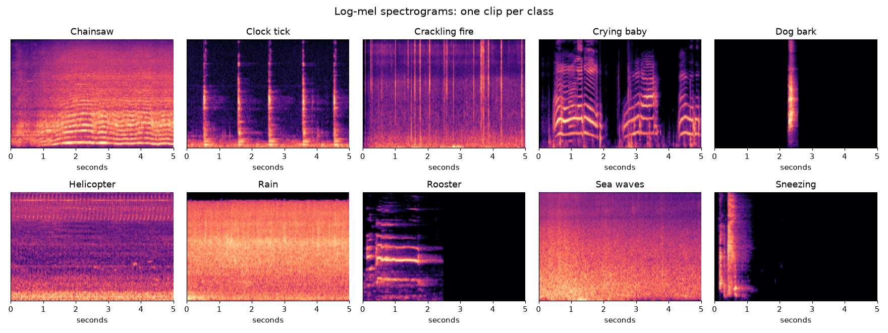
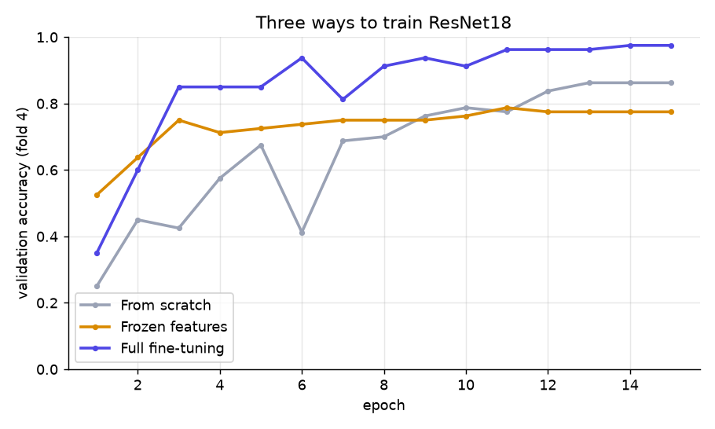

# Environmental Sound Classifier

Recognises 10 everyday sounds (dog bark, rain, crying baby, chainsaw and others) from a 5-second audio clip, using a ResNet18 trained on log-mel spectrograms.

**[Live demo →](LIVE_DEMO_URL)**: play one of the bundled clips, upload your own audio file or record 5 seconds from your microphone. Your browser computes the spectrogram and runs the model (ONNX Runtime Web), so no server is needed.



## Results

The main question was **how much ImageNet pre-training helps on a tiny audio dataset**. I trained the same ResNet18 three ways, with the same data, epochs and augmentation. Validation is fold 4 and test is fold 5, with 80 clips each:

| Strategy | Trainable params | Learning rate | Val accuracy | Test accuracy |
|---|---|---|---|---|
| From scratch (random weights) | 11.2M | 1e-3 | 86.3% | 72.5% |
| Frozen ImageNet features (train the head only) | 5,130 | 1e-2 | 78.8% | 75.0% |
| **Full fine-tuning** (chosen on validation) | 11.2M | 1e-3 | **97.5%** | **91.3%** |

Results for the chosen model on the test fold:

| Metric | Score |
|---|---|
| Accuracy | **91.3%** |
| Macro F1 | 0.911 |
| Top-3 accuracy | 97.5% |
| Web model (int8 weights, 11 MB) accuracy | 90.0% (98.8% of predictions identical to PyTorch) |



## Key findings

- **Pre-training wins clearly, as long as the network is allowed to adapt.** Full fine-tuning beats training from scratch by about 19 points on the test fold.
- **Frozen photo features only transfer partly.** Training only the classifier head gives the best first epoch, but it levels off below 80%.
- **Training from scratch overfits.** With 11M parameters and only 240 training clips it reaches 86% on validation but 72.5% on test.
- **Main weakness: helicopter vs rain.** Half of the helicopter test clips are predicted as rain, since both are steady wide-spectrum noise. Almost every other class is perfect.
- **The learning rate matters for fine-tuning.** With 3e-4 (the original setting) fine-tuning was still underfitting after 15 epochs (val 84%, test 76%). These timm weights (`resnet18.a1_in1k`) were trained with a very different recipe, and 1e-3 adapts them much better.

## Approach

1. **Data:** this uses ESC-10, the 10-class subset of ESC-50: 400 clips of 5 seconds each, 40 per class. I used the official folds (1–3 train, 4 validation, 5 test), so clips cut from the same recording never end up in two splits.
2. **Features:** each clip is resampled to 22,050 Hz and converted with librosa to a 128-bin log-mel spectrogram (n_fft 1024, hop 512, so 216 frames). Values are in dB relative to the clip's maximum with an 80 dB floor, then scaled with `(dB + 40) / 20`.
3. **Model:** ResNet18 from `timm`. The 1-channel spectrogram is repeated to 3 channels. **CPU budget:** the spectrogram is 2×2 average-pooled to 64 × 108 inside the model, and each strategy trains for 15 epochs. A full run takes about 11 minutes on a 4-core laptop CPU.
4. **Training:** AdamW with a cosine schedule. Augmentation is a random time shift plus SpecAugment frequency and time masks. I kept the best epoch on validation. In the frozen variant BatchNorm stays in eval mode, so its ImageNet statistics stay frozen too.
5. **Selection:** the strategy is chosen by validation accuracy. The test fold is only used to report the final numbers.
6. **Export:** the model (including softmax) is exported to ONNX at opset 17 and checked against PyTorch (max probability difference 5e-6). Conv weights are then stored as int8 with per-channel scales and `DequantizeLinear`, which takes the file from 45 MB to 11 MB. Activations stay float32.
7. **Same preprocessing in the browser:** `web/mel.js` re-implements the librosa pipeline: centred STFT with zero padding, periodic Hann window, power spectrum, librosa's own mel filterbank (exported to `mel_filters.json`), `power_to_db(ref=max, top_db=80)` and the same normalisation. I checked it two ways:
   - a numpy port in `train.py` (`js_logmel_numpy`) matches librosa to **1.2e-5 dB** on all 80 test clips, with identical predictions;
   - the real `mel.js` plus `onnxruntime-web` (run in Node on the same clips) gives the **same predictions as Python on 80 of 80 clips** (max probability difference 1e-6).

   The one step that is not bit-exact is resampling: the browser's `OfflineAudioContext` resamples differently from librosa's soxr. Swapping in a different resampler (scipy `resample_poly`) changed 1 prediction out of 80 test clips.

## Fixes compared with the original lesson notebook

- `torch.device = 'cuda' if ...` overwrote the `torch.device` class with a string. Now everything runs explicitly on CPU.
- `fit(..., lr)` ignored its `lr` argument (it always used `1e-3`), so the three strategies never used their intended learning rates. That is fixed.
- The best epoch is now picked on validation. Before, the last epoch was evaluated on test. The model is also chosen on validation instead of being fixed in advance.
- In the frozen-feature run, BatchNorm statistics were silently updated even though the weights were "frozen". It now runs in eval mode.
- `predict()` gave the model a 128-row spectrogram, but the model had been trained on inputs stretched to 256 rows. Now it uses exactly the training preprocessing and returns the top-3 classes.

## Project structure

```
├── notebook.ipynb     # dataset overview, spectrograms, three strategies compared, confusion matrix (with outputs)
├── train.py           # download → features → train 3 strategies → evaluate → ONNX + web assets
├── requirements.txt
└── web/               # static demo deployed on Vercel
    ├── index.html, app.js, style.css
    ├── mel.js            # log-mel spectrogram in JavaScript (matches librosa)
    ├── mel_filters.json  # librosa's mel filterbank + STFT settings
    ├── model.onnx        # ResNet18, int8 weights
    ├── meta.json         # metrics, comparison, example list
    ├── examples/         # 10 test-fold clips (one per class)
    └── assets/           # charts
```

## Run locally

```bash
pip install -r requirements.txt
python train.py                         # downloads ESC-10 (~180 MB), trains, writes web/
python -m http.server 8000 -d web       # open http://localhost:8000
```

`train.py` downloads only the 400 ESC-10 files from the official ESC-50 GitHub repository, not the full 650 MB archive. They are cached in `data/`.

## Tech

Python · PyTorch · timm · librosa · scikit-learn · ONNX / ONNX Runtime Web · Web Audio API · Vercel

## Dataset and license

**[ESC-50: Dataset for Environmental Sound Classification](https://github.com/karolpiczak/ESC-50)** by Karol J. Piczak (ACM Multimedia 2015). The clips come from [freesound.org](https://freesound.org). The dataset is licensed under **Creative Commons Attribution-NonCommercial 3.0 (CC BY-NC 3.0)**, so this project and the 10 example clips bundled in `web/examples/` are for non-commercial use only. The source recording of each example is listed in `web/meta.json`.
